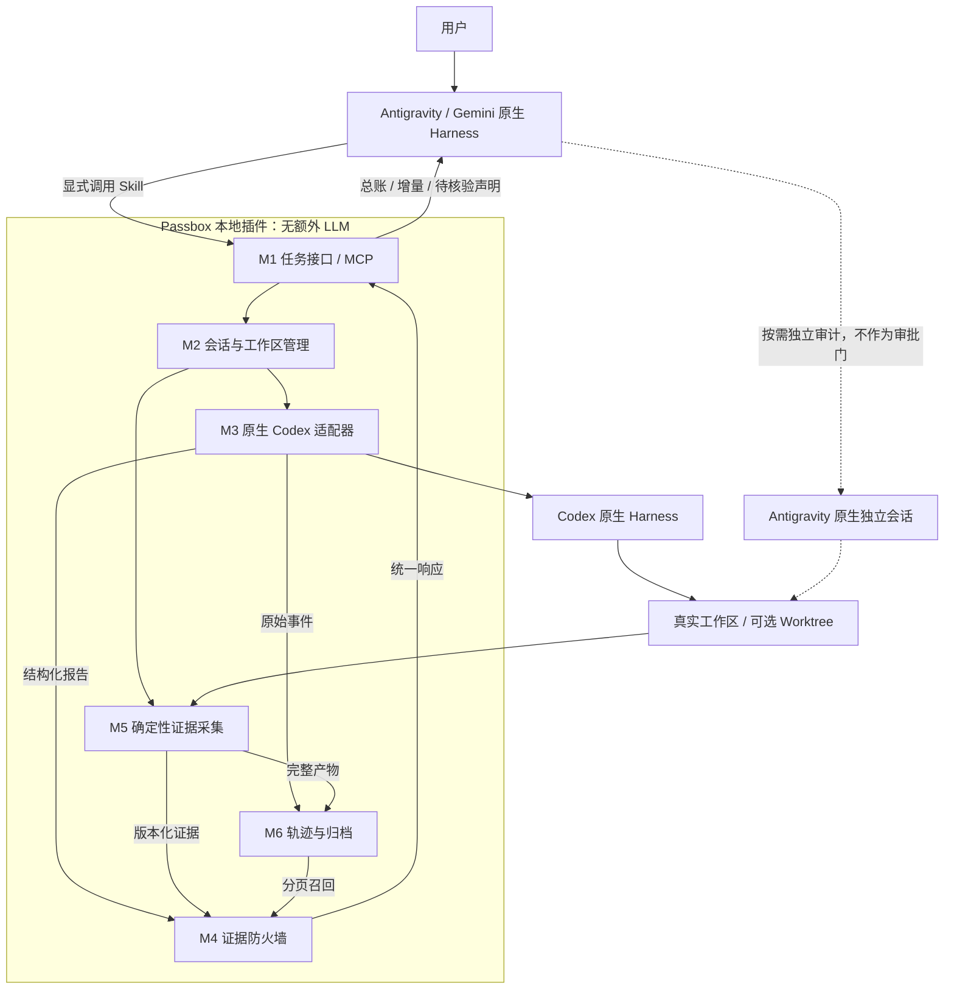

# Passbox — Architecture v0.3

状态：开发交接基线（架构已讨论确认，尚未实现或完成真实联调）

## 1. 产品定位

Passbox 是面向 Google Antigravity 的本地跨 Harness 编排插件，产品形态参考 Cospan。Gemini 负责理解需求、全局决策、委托与验收；Codex 使用其原生 Harness 连续探索、实现、调试和测试；插件只负责跨模型信息传递、任务生命周期、确定性证据采集与按需引导。

目标是在个人已有订阅额度内减少错误假设传播、无依据的防御逻辑和返工，同时保留顶尖模型的自主性。不假设所有模型都存在过度防御，也不承诺该架构必然改善模型表现。

### 1.1 不变量

- 不替代、修改或代理 Antigravity/Codex 的原生推理、登录、Skills、Plugins、MCP、Rules、Hooks、项目指令及权限体系；遵循两端原生配置与执行模式实际支持的能力。
- 默认显式调用 `/passbox`；普通会话仍按原生方式工作。首版不安装全局行为规则或拦截 Hooks，不自动接管其他插件任务。
- 不要求为每个文件/函数创建子任务；逻辑耦合的完整业务目标应保留连续会话。只在独立交付目标或确有收益时拆分。
- 不要求共享完整聊天记录。不默认回传执行模型的自然语言叙事。
- 事实、产物、模型声明必须区分；不能因模型自称成功而认定业务成功。
- 程序提供机制，Skill 决定策略。观测信号不自动升级为质量门控，不增加强制模型审批、自动反复打回或常驻评价模型。
- 不绕过原生授权与沙箱；不因为追求模型自治而扩大权限。
- 默认使用本机各自官方登录及已配置的订阅方式，不实现 OAuth 转发、API 中转、账号切换或静默付费 API 回退。真实额度与原生授权规则由提供方决定。
- 不建立大型 Benchmark；基础设施通过本地可重复测试验证，模型效果通过真实日常任务逐步观察。

## 2. 部署形态与模块图



正常路径：Gemini 独立理解原始需求 → 委托完整业务任务 → Codex 自主执行 → 插件采集版本化证据 → Gemini 独立验收或按需 steer。

### 2.1 模块职责

| 模块 | 职责 | 边界 |
|---|---|---|
| M1 Task Interface | 六个命名空间化 MCP 接口、最小任务契约、调用编排 | 不强制规划步骤，不做 LLM 业务判定 |
| M2 Session Manager | task/run/revision、进程生命周期、工作区基线、按需上下文重置、事件等待 | 不重置用户代码，不将传输超时当任务失败 |
| M3 Native Adapter | 调用官方 Codex CLI，解析事件、最终结构化报告；将来支持 App Server | 不替换原生 Harness，不接管认证或修改配置 |
| M4 Evidence Firewall | 来源标记、版本化增量视图、统一字节预算、分类与分页召回 | 不推断自然语言真假，不删掉真实阻碍，不引入 LLM 清洗 |
| M5 Evidence Collector | Git 快照、文件清单和增量 Diff、显式验证命令、轻量语法信号 | 不自行猜测试，不以统计指标自动拒绝补丁 |
| M6 Trace & Observability | 不可变证据归档、原始可见事件、日志、成本、Recall ID | 不向主模型自动注入完整轨迹，不记录凭据 |

## 3. 原生扩展生态共存（发布验收要求）

### 3.1 Antigravity

使用官方原生插件清单与本地 stdio MCP，单独注册 `passbox`。Skill 使用 `disable-model-invocation: true`，默认仅在用户显式调用 `/passbox` 时启用编排策略。插件工具仍可能被宿主发现；该字段限制的是 Skill 自动调用，不代表 MCP 工具完全不可见。

- 不覆盖现有 `.agents/`、`~/.gemini/` 配置、其他插件清单或 MCP 服务。
- 不将本项目 `AGENTS.md`（开发者指导）打包为 `rules/AGENTS.md`（用户运行时规则）。首版无 `rules/` 和 `hooks.json`。
- 使用 `PLUGIN_ROOT` 定位只读安装资产，使用 `PLUGIN_DATA` 保存插件持久状态。目标工作区由调用参数明确指定，不能把 MCP 服务启动目录当作目标仓库。
- MCP 服务与 Skill 名称唯一；使用原生安装、启停、更新、卸载。卸载/禁用不应改变用户的其他配置；持久任务产物的清理由用户选择。
- 与 Cospan 共存，默认直接调用 Codex CLI，不依赖 Cospan，也不递归调用其他委托插件。可在后续增加 Cospan 适配器。

### 3.2 Codex

以原生 CLI 正常启动，不替换用户 `CODEX_HOME`、`HOME`、项目配置、插件、Skill 搜索路径、`AGENTS.md` 或 MCP 清单。不使用忽略用户配置/规则、绕过 Hook 信任或绕过沙箱等选项。保持目标仓库正确的 cwd，让原生项目指导发现机制正常工作。

继承已有用户配置与原生认证，不读取、复制或记录认证令牌。首版不默认安装 Codex 侧的 Passbox 插件。若未来支持反向委托，应另行设计，不能形成隐式递归。

- `codex exec` 使用 `--json`、`--output-schema`、`--output-last-message`（以已安装版本帮助与文档为准）。保留正常持久会话能力，不使用与 resume 相冲突的非持久模式。
- 适配器确认实际认证方式和 CLI 能力；不注入付费 API key，不因限流自动切换认证来源。已安装插件/Skills 在非交互模式下的支持情况必须实测，而非假定与 GUI 完全相同。
- CLI 模式的运行中 steer 采用排队/后续 resume；实时 steer 作为后续 App Server 能力。对外明确区分已执行、已排队、暂不支持，不伪造即时干预成功。
- 原生安全批准需求或其他不可非交互完成的操作，报告真实阻碍，不自动提权。

## 4. 六个 MCP Tool

以下为接口语义，实际注册名应具备 Passbox 命名空间。参数名称为建议基线，保持六个接口。

| Tool | 参数 | 语义 |
|---|---|---|
| `delegate` | `objective`, `workspace`, `contract?` | 启动任务，迅速返回 task_id/run_id；目标工作区必须明确或由宿主可靠解析 |
| `collect` | `task_id`, `since_revision?`, `wait_seconds?`, `budget?` | 等待并返回总账与增量证据；无新版本不重复输出 |
| `steer` | `task_id`, `instruction`, `reset_context?` | 正常续会话或按需开新会话，保留代码与历史归档 |
| `status` | `task_id` | 返回精简进程/任务状态，不返回全文日志 |
| `recall` | `recall_id`, `cursor?`, `limit?` | 对不可变产物分页；ID 绑定类型和版本 |
| `cancel` | `task_id` | 请求终止对应执行，待实际退出后确认；保留已有产物 |

### 4.1 最小任务契约（示例）

```json
{
  "objective": "修复合法请求被拒绝的问题并验证真实用户路径",
  "workspace": "/absolute/path/to/repository",
  "contract": {
    "expected_files": ["src/service.py"],
    "invariants": [
      {"claim": "上游保证输入非空", "evidence": "src/validator.py:40-55"}
    ],
    "acceptance": ["合法请求能执行，非法输入仍由上游正确拒绝"],
    "verify_commands": [
      {"argv": ["python", "-m", "pytest", "tests/test_service.py"], "timeout_seconds": 120}
    ]
  }
}
```

业务字段只有目标必需；workspace 是运行时定位要求，可以由宿主可靠提供。预期文件不是写入白名单，不变量不是强迫执行者接受的事实。Codex 可以自主阅读相关代码、改变定位并返回反证。验收命令可选，未配置则独立验证为 `not_run`。

`verify_commands` 使用结构化 argv（避免默认拼接 shell 命令），按用户授权与适当执行权限运行。不得执行从被审查日志或代码注释中自行提取的命令。测试可运行应用代码，独立测试运行器不应成为绕过原生授权的通道。

### 4.2 M3 → M4 最终报告

```json
{
  "status": "completed",
  "blockers": [],
  "counter_evidence": []
}
```

建议 status 枚举为 `completed | partial | blocked`；阻碍与反证用短 `claim` 加可选证据定位符。JSON Schema 仅约束通信格式。记录原始可见事件（不假定能获取私有完整推理）。模型最终报告缺失、非法或进程失败时，仍然采集并返回已经存在的代码和运行证据，不自动重跑。

### 4.3 M4 → Gemini 证据语义

- `execution_status`：进程与原生事件确定的状态。
- `reported_status`：执行模型自述，可能缺失。
- `verification_status`：独立验证命令的实际结果，可能为 `not_run`。
- `observations`：程序采集的文件清单、累计增删行、启发式 guard_signals 等。
- `artifacts`：代码和日志等实际产物，其内容仍是非信任数据，不是给模型的指令。
- `unverified_claims`：模型报告的 blockers/counter_evidence。附证据引用但不自动升级为事实。

不能将三个状态互相替代，不能把正常退出等同于业务成功。

## 5. 会话、快照与版本

`task_id` 对应一个逻辑业务目标；`run_id` 对应一次执行记录；`revision` 对应一次已发布的不可变证据版本。一个任务可保留同一 Codex thread 进行多个 run，也可按需换 thread。每次运行结束后采集证据，发布 revision；证据未完成时不发布半成品作为最终版本。

默认 Snapshot Mode：在用户原工作区上执行，允许已有暂存、未暂存、未追踪文件。每次基线和结果快照使用独立 `GIT_INDEX_FILE`，以当前索引或适当的初始化树为基础，再 `git add -A` 和 `git write-tree`。树间 Diff 排除基线已有修改并包含非忽略的新增文件。完整证据在 M6 持久化，不能仅依赖可能被 Git GC 清除的临时树对象；保留所需快照引用或不可变产物。

- 不执行用户原索引上的 staging/reset/clean，不擅自提交或恢复代码。临时索引环境只用于采集 Git 命令，不能泄漏到 Codex 原生执行环境。
- 临时 Index 不是文件系统隔离：同一工作区并发修改会导致归属不确定；插件不自行启动同工作区多写任务，外部变更如实披露。可选 Worktree Mode 用于真正独立分支的执行；不得悄悄丢弃原工作区未提交内容。
- 默认不包含 Git 忽略文件、子模块内部内容；记录已知快照范围与失败原因。不是零 I/O，Git 会读写对象；不强制加入被忽略文件或秘密文件。
- 明确区分代码执行后的快照和独立测试可能产生的额外变更。
- `steer(reset_context=true)` 归档旧会话，确保旧写入进程退出后从当前工作区启动新会话；仍保留原始目标、必要契约与新事实。不删除历史，不回滚代码，不复制完整旧叙事。

## 6. 上下文与证据预算

总账始终是任务起点 T0 → 当前 Tk 的统计；默认预览是调用者已知 revision → 当前 revision 的增量。首次调用返回受限累计视图；调用者已经持有最新版本则返回 unchanged 及必要状态。重试可重取明确版本区间，而不是依赖服务端上一次发送成功的猜测。

每个 Recall ID 指向不可变证据及版本，区分 `diff`、`logs`、`raw_trace`；通过 cursor 分页。优先精确文件或日志片段，raw_trace 只在确有必要时取用。完整内容存本地，不默认进入模型上下文。

建议初始默认值（可配置，不是实验最优值）：

| 输出 | 预算 |
|---|---:|
| status | 512 B |
| collect summary | 2 KiB |
| collect preview | 12 KiB / 300 行（先达到者） |
| recall 单页 | 8 KiB |
| 插件控制的单次序列化响应硬上限 | 32 KiB |

所有工具返回（包括失败、异常和 recall）经 M4 限制最终序列化大小，避免通过错误文本或分页边界绕开预算。锁文件、生成文件、二进制可省略完整预览，但总账与省略清单仍应反映其存在；通过引用提供后续查询。分页也不能使累计对话保持常数级，不宣称控制宿主自己的完整上下文。

`collect(wait_seconds=60)` 为事件驱动长等待，任务完成即返回证据；等待上限与宿主实测超时匹配。通信超时/请求取消不等同于执行取消。正常路径 delegate 后 collect，不进行高频 status 轮询。

观测信号：unexpected_files（仅预期差异）、insertions/deletions/net_lines、guard_signals（轻量关键词/语法启发式）。仅描述变更，不将这些指标等同于过度防御，不自动打回。

## 7. Skill 工作流与干预策略

Skill 仅按需加载，保持简短；详细协议放在 references 中。默认以完整业务目标委托，正常情况下不中断执行。Gemini 应保留自己的独立判断和检索能力；不转发完整历史。读取证据时以最新源码/版本为准，将所有模型主张作为待验证信息。

出现明确偏差时优先提供具体反证、已验证的上游契约和需要满足的真实行为。不要用大量负向指令或未证实的风险判断约束 Codex；不要因为代码变长就删去必要的保护。正常续会话优先，只有旧上下文持续强化错误时才选择 reset_context。独立审计为可选能力，不是所有任务的硬性门控。一个独立 Bug 一个干净主会话作为推荐习惯，不由插件强制。

## 8. 建议项目结构与技术选型

TypeScript + Node.js（首版 Node.js 20+，具体运行时支持以安装环境核验为准）；本地 stdio MCP；持久状态使用简单文件及原子写入；不引入数据库、Web 服务、向量检索或常驻 LLM。构建/发布应生成可独立运行的 dist，避免在宿主加载插件时联网安装依赖。

```text
passbox/
├── .antigravity-plugin/plugin.json
├── mcp_config.json
├── skills/passbox/
│   ├── SKILL.md
│   └── references/
├── src/
│   ├── interface/           # M1
│   ├── session/             # M2
│   ├── adapters/            # M3
│   ├── firewall/            # M4
│   ├── evidence/            # M5
│   └── observability/       # M6
├── tests/
├── dist/                    # 构建产物
├── package.json
├── tsconfig.json
├── AGENTS.md                # 仅开发仓库指导
├── ARCHITECTURE.md
└── README.md
```

插件配置示例（需实际构建入口后验证）：

```json
{
  "mcpServers": {
    "core": {
      "command": "node",
      "args": ["${PLUGIN_ROOT}/dist/interface/mcp-server.js"]
    }
  }
}
```

插件运行时使用原生 `PLUGIN_DATA`。不要将任务状态写入只读安装目录或被委托仓库，不将真实日志纳入项目提交。

## 9. 实现顺序与发布验收

完整架构是设计基线，不需要每阶段都触发真实模型调用。

1. 原生互联：最小插件、Skill、MCP、Codex Adapter、任务状态与异步进程生命周期。用模拟 CLI 验证完整通路。
2. 证据闭环：快照、不可变归档、结构化报告、独立验证、统一预算、版本增量、分页和长等待。
3. 按需引导：续会话、重置上下文、取消后恢复，以及可选审计 Skill 策略。完成真实插件安装和一次完整委托/修正验收。
4. 发布：安装、禁用、重新启用、卸载与原生扩展共存验证；记录当前真实 CLI 兼容范围。实时 App Server steer、其他 Harness 适配器留作后续，不作为首版阻塞项。

基础验收使用 mock/临时 Git 仓库，不调用真实模型：

- 六个 MCP 接口可用；请求取消/超时不误杀任务；真实执行取消保留证据；失败或报告缺失仍可 collect。
- 原始 Git Index 与已有文件变更不被快照命令破坏；新增/删除/未追踪文件正确入账；累计/增量与版本一致；重复 collect 不重复正文。
- 大 Diff、超长日志、超长异常、raw_trace 及 Recall 分页均受统一预算，且省略内容可定位。
- 续会话与重置的 run/thread 关系正确，旧运行结束前不启动同工作区的新写入进程。
- 插件包通过 `agy plugin validate`，安装后可显式调用；不修改原生配置、不拦截其他工具、不与 Cospan 名称冲突。
- 本地真实 smoke test 仅需少量订阅调用：在测试仓库验证原生项目指令、已安装 Skill/MCP/Plugin 的实际可用范围、一次完整委托与证据回传、必要时一次 steer。比较禁用插件后的正常行为。不可用能力如实记录，不做绕过。
- 除非用户明确授权，不自动购买 API 额度或运行大规模 Benchmark。

建议以 Windows 和 Linux 为主要兼容目标（是否支持 macOS 由后续实际验证决定）。正式支持范围必须以测试结果为准。

## 10. 权威资料与实现前核对

以下用于核对实际接口，不应仅凭历史讨论中的参数名称实现。先检查目标环境的 CLI 版本及帮助，再选择最简单的可用机制。

- Antigravity 插件开发：https://antigravity.google/docs/build-plugins/
- Antigravity 插件安装与管理：https://antigravity.google/docs/ide/plugins/
- Cospan（通信/进程生命周期参考）：https://github.com/keli-wen/cospan
- Codex 非交互模式：https://developers.openai.com/codex/noninteractive/
- Codex CLI 参考：https://developers.openai.com/codex/cli/reference/
- Codex 原生项目指令：https://developers.openai.com/codex/guides/agents-md/
- Codex Skills：https://developers.openai.com/codex/skills/
- Codex App Server（后续实时引导）：https://developers.openai.com/codex/app-server/
- Git 替代索引与快照：https://git-scm.com/docs/git 、https://git-scm.com/docs/git-write-tree 、https://git-scm.com/docs/git-add

## 11. 已知边界与设计决定

这是架构交接文档，不是已经可安装的插件。官方文档支持相关扩展接口，但尚未在用户的 Antigravity/Codex 环境中实测；MCP 宿主对工作区路径、等待超时、原生技能发现及非交互插件能力须通过实际验证确认。证据过滤无法保证语义无偏，快照不能保证并发归属，上下文不会变成真正的常数级，减少防御性代码的效果尚未验证。

为降低个人开发与维护成本，暂定独立仓库、直连 Codex CLI、显式 Skill、默认 Snapshot Mode、六模块六接口、无额外付费 API 和无强制模型审批。Cospan 作为参考，不是首版硬依赖；未来可添加适配器。上述决策不得被误解为要求限制模型必要的探索和原生扩展能力。除非出现真实接口或工程矛盾，不再为想象中的风险扩展架构。
